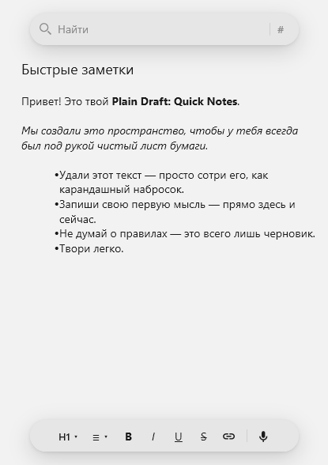

# Plain Draft: Quick Notes

Быстрые заметки. Фиксируйте свои идеи в Plain Draft: Quick Notes.

**Платформа:** Windows 10/11, win-x86 · **Стек:** WPF, .NET 8

## Возможности

- Ничего лишнего — один лист с поиском и панелью инструментов
- Глобальные горячие клавиши «Перейти к заметке» и «Показать / Скрыть»
- Текст в RichTextBox: заголовки, списки, B/I/U/S, ссылки
- Метки `#Имя` — кнопка # в строке поиска, переход по списку
- Печать из трея: принтер, ориентация, масштаб, диапазон, предпросмотр
- Светлая и тёмная темы
- Голосовой ввод текста через системную диктовку Windows (Win+H)

## Скачать

Готовые сборки — на [странице релизов](https://github.com/yurymikitchuk/PlainDraft/releases/latest):

| Архив | Описание |
|-------|----------|
| `PlainDraft-*-win-x86-dotnet.zip` | ~0,1 MB; нужен [.NET 8 Desktop Runtime x86](https://dotnet.microsoft.com/download/dotnet/8.0) |
| `PlainDraft-*-win-x86-full.zip` | ~53 MB; self-contained, runtime не нужен |

Распакуйте и запустите `PlainDraft.exe`.

Параметры запуска (опционально): `-minimized` / `/minimized` / `-hidden` / `/hidden`.

## Лицензия

[MIT](LICENSE)
